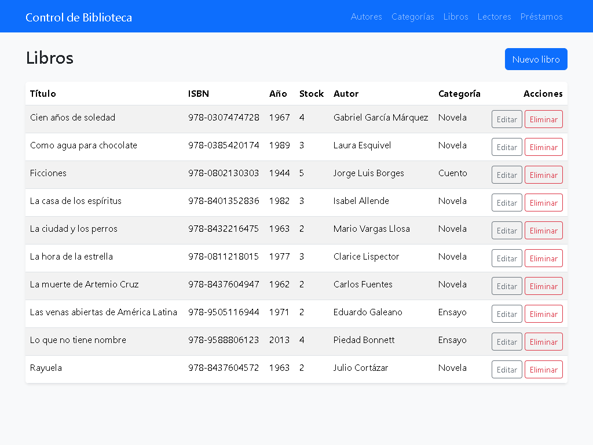
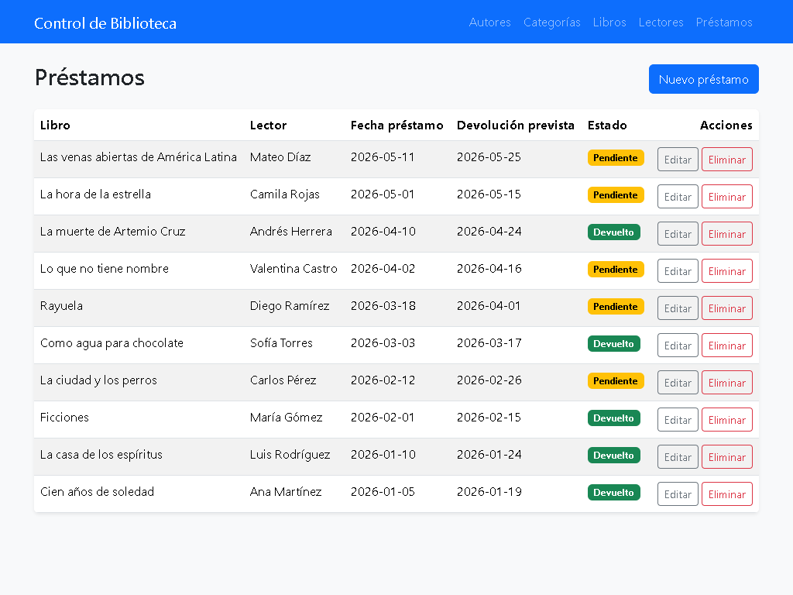

# Control de Biblioteca

Aplicación web sencilla para administrar autores, categorías, libros, lectores y préstamos usando Python 3, Flask y PostgreSQL.

## Información del proyecto

- **Integrantes:** agregar los nombres completos de los integrantes del grupo.
- **Tema:** gestión de una biblioteca (catálogo, lectores y préstamos).
- **Diagrama MER:** [ver diagrama](docs/mer.svg).
- **Diccionario de datos y normalización:** [ver documento](docs/diccionario_datos.md).
- **Plan de pruebas:** [ver casos funcionales](docs/plan_pruebas.md).

## Requisitos

- Python 3.10 o superior
- Docker con Docker Compose

## Preparación

1. Copia `.env.example` a `.env` y ajusta `POSTGRES_PASSWORD` y `SECRET_KEY`.
2. Desde la raíz del proyecto, inicia PostgreSQL:

   ```powershell
   docker compose up -d
   ```

3. Crea y activa un entorno virtual, e instala las dependencias:

   ```powershell
   py -m venv .venv
   .\.venv\Scripts\Activate.ps1
   pip install -r requirements.txt
   ```

4. Crea las tablas y carga los datos de ejemplo:

   ```powershell
   cmd /c "docker compose exec -T db psql -v ON_ERROR_STOP=1 -U biblioteca -d biblioteca < database\schema.sql"
   cmd /c "docker compose exec -T db psql -v ON_ERROR_STOP=1 -U biblioteca -d biblioteca < database\seed.sql"
   ```

   Si cambiaste `POSTGRES_USER` o `POSTGRES_DB`, reemplaza `biblioteca` en esos comandos.
   Para importar el respaldo SQL, usa el siguiente comando en vez de cargar los dos scripts:

   ```powershell
   cmd /c "docker compose exec -T db psql -v ON_ERROR_STOP=1 -U biblioteca -d biblioteca < database\backup.sql"
   ```

5. Ejecuta la aplicación:

   ```powershell
   python app.py
   ```

   Abre <http://127.0.0.1:5000>.

## Pruebas funcionales

Con PostgreSQL iniciado, el esquema y los datos cargados, ejecuta:

```powershell
python -m unittest discover -s tests -v
```

La suite comprueba 15 escenarios CRUD, validación de entradas y restricciones de claves foráneas. Consulta [el plan de pruebas](docs/plan_pruebas.md) para el detalle.
La salida de la última ejecución correcta está guardada en [resultado_pruebas.txt](docs/capturas/resultado_pruebas.txt).

## Respaldo de PostgreSQL

`database/backup.sql` es un volcado SQL de PostgreSQL. Para regenerarlo después de cargar y verificar la base:

```powershell
cmd /c "docker compose exec -T db pg_dump -U biblioteca -d biblioteca --no-owner --no-privileges > database\backup.sql"
```

## Capturas

Las evidencias de las cinco vistas principales se guardan en [`docs/capturas/`](docs/capturas/). Ejemplos:





La aplicación se conecta a PostgreSQL en `localhost:5432` por defecto. Puedes ajustar
`DB_HOST` y `DB_PORT` en `.env` si utilizas otro host o puerto.
